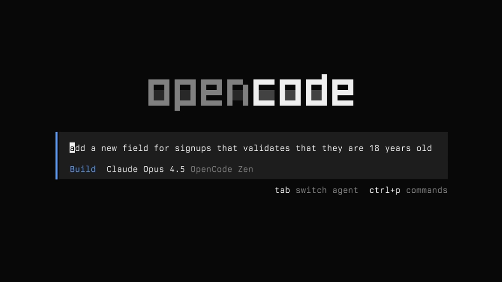

<div align="center">

# OpenCode Cheat Sheet

<a href="https://opencode.ai/"></a>

> A working reference for OpenCode v2. Every command below was checked against `opencode 2.1.4` and the [v2 docs](https://opencode.ai/v2/docs/).

</div>

> **Coming from OpenCode v1?** v2 changed a lot. The CLI commands `agent`, `attach`, `web`, `github`, `pr`, `db`, and top-level `export`/`import` are gone. `providers` is now `auth`, `--mini` is now the `mini` subcommand, and `tui.json` is now a single global `cli.json`. See [Migrating from v1](#migrating-from-v1).

## Quick Start

```bash
# Install v2 (recommended)
curl -fsSL https://opencode.ai/v2/install | bash

# Or with a package manager
npm install -g @opencode/cli
bun install -g --trust @opencode/cli
pnpm add -g --allow-build=@opencode/cli @opencode/cli
yarn global add @opencode/cli
brew install anomalyco/tap/opencode-v2
vp install -g @opencode/cli
mise use -g opencode
paru -S opencode-beta

# Launch and check the version
cd /path/to/project
opencode
opencode --version
```

The npm package uses a postinstall script to pick the right native binary. Bun and pnpm need the extra flag above to allow that script.

## Table of Contents

- **[Level 1: Getting Started](#level-1-getting-started)**
- **[Level 2: Basic Commands](#level-2-basic-commands)**
- **[Level 3: Intermediate Usage](#level-3-intermediate-usage)**
- **[Skills](#skills)** — Reusable, on-disk capabilities
- **[Level 4: Advanced Features](#level-4-advanced-features)**
- **[Level 5: Expert Workflows](#level-5-expert-workflows)**
- **[Command Reference](#command-reference)**
- **[Migrating from v1](#migrating-from-v1)**
- **[Best Practices](#best-practices)**

## Level 1: Getting Started

<details>
<summary><strong>Installation</strong></summary>

```bash
curl -fsSL https://opencode.ai/v2/install | bash

npm install -g @opencode/cli
bun install -g --trust @opencode/cli
pnpm add -g --allow-build=@opencode/cli @opencode/cli
yarn global add @opencode/cli
brew install anomalyco/tap/opencode-v2
vp install -g @opencode/cli
mise use -g opencode
paru -S opencode-beta

opencode --version
```

Windows package managers are not supported. Use WSL, or download a standalone binary from [opencode.ai](https://opencode.ai/v2/docs/).

Docker images use versioned tags:

```bash
docker run -it --rm ghcr.io/anomalyco/opencode:2.0.0
```

</details>

<details>
<summary><strong>First Steps and Authentication</strong></summary>

```bash
opencode                          # TUI in the current directory
opencode /path/to/project         # TUI in a specific project

opencode auth login               # add a provider and paste its API key
opencode auth list                # list authenticated providers
opencode auth logout              # log out of a provider
```

Credentials live in `~/.local/share/opencode/auth.json`. In the TUI, `/connect` opens the same flow.

OpenCode reads the provider list from [models.dev](https://models.dev), so `opencode auth login` works for any provider in that catalog, not just the ones OpenCode ships.

</details>

<details>
<summary><strong>Initialize a Project</strong></summary>

```bash
# Inside the TUI
/init
```

`/init` walks the project and writes an `AGENTS.md` with the structure and conventions it found. Commit it so every session starts with the same context.

</details>

<details>
<summary><strong>Basic Navigation</strong></summary>

```bash
# Message prefixes
@path/to/file.ts         # fuzzy file reference, contents go into context
@src/auth.ts#20-45       # a line range
!ls -la                  # run a shell command, output stays in the session

# Keybinds (leader key: ctrl+x)
ctrl+x n                  # new session
ctrl+x l                  # list and switch sessions
ctrl+x u                  # undo the last message and its file changes
ctrl+x r                  # redo an undone message
ctrl+x c                  # compact the session
ctrl+x e                  # open the external editor
ctrl+x x                  # export to Markdown
ctrl+x m                  # list models
ctrl+x a                  # list agents
ctrl+x t                  # list themes
ctrl+x q                  # exit
ctrl+p                    # command palette
shift+tab                 # cycle primary agents
f2                        # cycle recently used models
ctrl+t                    # cycle model variants
```

</details>

## Level 2: Basic Commands

<details>
<summary><strong>Slash Commands</strong></summary>

Type `/` in the TUI to see the list for your build. In v2:

```bash
# Agent
/agents                   # choose an agent
/models                   # list models
/variants                 # choose a reasoning variant (aliases: /thinking, /effort)

# Session
/new                      # start a new session
/sessions                 # list and switch (aliases: /resume, /continue)
/open                     # open a project (aliases: /projects, /project)
/fork                     # fork the session
/rename <arg>             # rename the session
/timeline                 # session timeline
/compact                  # compact the context
/undo                     # undo the last message and its changes
/redo                     # restore an undone message
/clear                    # clear the transcript
/copy                     # copy the last message
/export                   # export to Markdown
/worktrees                # list worktrees
/cd <arg>                 # change directory

# System
/connect                  # add a provider
/mcps                     # MCP servers
/plugins                  # plugins
/settings                 # settings
/stats                    # usage statistics
/status                   # session status
/themes                   # list themes
/update                   # check for and install an update
/restart                  # restart the server
/pair                     # pair a browser or app (alias: /web)
/reload                   # reload configuration
/highlights               # release notes
/help                     # help dialog
/exit                     # quit (aliases: /quit, /q)
/debug                    # debug menu
/diff                     # diff view
/terminal                 # terminal panel

# Other
/btw <arg>                # side question, not added to the conversation
/skills                   # list available skills
/editor                   # compose in $EDITOR
```

`/init` and `/review` are server-side commands. `/review` takes an optional commit, branch, or PR and defaults to uncommitted changes.

</details>

<details>
<summary><strong>Agents: Build vs Plan</strong></summary>

v2 ships four visible agents. Switch between primary agents with **Shift+Tab**.

- **Build** (`build`, primary) - the default, with full tool access.
- **Plan** (`plan`, primary) - explores and plans without editing project files.
- **General** (`general`, subagent) - multi-step work with broad tool access.
- **Explore** (`explore`, subagent) - reads and searches code or web sources without editing.

There is no `scout` agent in v2. That was a v1 built-in.

Subagents run in a child session. The parent agent's `subagent` permission decides which ones it may launch, and the child uses its own permissions.

```jsonc
{
  "agents": {
    "orchestrator": {
      "permissions": [
        { "action": "subagent", "resource": "*", "effect": "deny" },
        { "action": "subagent", "resource": "reviewer", "effect": "allow" }
      ]
    }
  }
}
```

</details>

<details>
<summary><strong>File and Directory Operations</strong></summary>

```bash
# Reference files with @
"How is auth handled in @packages/functions/src/api/index.ts?"

# Reference a configured reference root
"Compare our setup with @docs/README.md"

# OpenCode reads, writes, and edits files as part of normal work
"Add error handling to src/utils.py"
"Create a new file called components/Button.tsx"
```

</details>

<details>
<summary><strong>Session Management</strong></summary>

```bash
# From the CLI
opencode session list                 # list sessions in the current project
opencode session list -n 10           # the 10 most recent
opencode session list --format json   # JSON instead of a table
opencode session delete <sessionID>   # delete a session and its children
opencode session export <sessionID> --sanitize   # export as JSON, secrets redacted
opencode session import session.json   # import from a file or URL

# Continue and fork
opencode -c                           # continue the last session
opencode -s <sessionID>               # resume a specific session
opencode -c --fork                    # fork, keeping the original intact
```

</details>

<details>
<summary><strong>Useful CLI Flags</strong></summary>

```bash
# Model selection (provider/model, optionally provider/model#variant)
opencode -m anthropic/claude-sonnet-5-5 "your prompt"
opencode run -m opencode/gpt-6.1-sol "explain this"

# Continue, resume, fork
opencode -c
opencode -s <sessionID> --fork

# Agent and prompt
opencode --agent plan "draft a migration plan"
opencode --prompt "summarize this repo"

# Auto-approve anything not explicitly denied
opencode run --auto "refactor src/"

# Connect to a server instead of the local one
opencode run --server http://localhost:49374 "explain async/await"
opencode --standalone                    # run a private server for this invocation
```

</details>

## Level 3: Intermediate Usage

<details>
<summary><strong>Configuration</strong></summary>

OpenCode uses JSON or JSONC (`opencode.json` / `opencode.jsonc`) and merges every file it finds, lowest precedence first:

1. `~/.config/opencode/opencode.json(c)` - your user config
2. `opencode.json(c)` files from the farthest ancestor directory down to the current one
3. `opencode.json(c)` files inside `.opencode/` directories, in the same order. These override every direct config.
4. The system directory: `/etc/opencode`, `/Library/Application Support/opencode`, or `%ProgramData%\opencode`
5. macOS managed preferences for the `ai.opencode.managed` domain, which users and projects cannot override

```jsonc
{
  "$schema": "https://opencode.ai/config.json",
  "model": "anthropic/claude-sonnet-5-5",
  "default_agent": "build",
  "update": "notify"
}
```

Terminal settings live in one global file, `~/.config/opencode/cli.json`. There is no project-local equivalent, and v1's `tui.json` is migrated automatically on first v2 start.

```jsonc
{
  "$schema": "https://opencode.ai/v2/cli.json",
  "theme": { "name": "opencode" },
  "leader": { "timeout": 2000 },
  "keybinds": { "command_list": "ctrl+p" }
}
```

See the [Config Reference](https://opencode.ai/v2/docs/config/) for the full schema.

</details>

<details>
<summary><strong>Model Selection</strong></summary>

```bash
opencode models                    # one provider/model ID per line
opencode models anthropic          # filter by provider
```

Set a default in config:

```jsonc
{
  "model": "anthropic/claude-sonnet-5-5"
}
```

Model IDs are `provider/model`. Add `#variant` to pin a reasoning effort, as in `provider/model#high`. The root `model` value drops the variant; agent and command references keep it.

OpenCode's own provider ID is `opencode`, covering the Zen and Console catalog. `opencode pair` and `/pair` in the TUI give you browser access.

</details>

<details>
<summary><strong>AGENTS.md for Project Context</strong></summary>

```bash
# Inside the TUI
/init
```

```markdown
# Project Guidelines

## Tech Stack
- Node.js with Fastify
- PostgreSQL
- Vitest

## Patterns
- Use dependency injection
- Prefer async functions for I/O
- Follow the existing ESLint rules
```

Point OpenCode at other instruction files with `instructions`:

```jsonc
{
  "instructions": ["CONTRIBUTING.md", "docs/guidelines.md", ".cursor/rules/*.md"]
}
```

v2 discovers `AGENTS.md` but not `CLAUDE.md`.

</details>

<details>
<summary><strong>Permissions</strong></summary>

v2 uses an ordered array of rules. The last matching rule wins, and no match means `ask`.

```jsonc
{
  "permissions": [
    { "action": "shell", "resource": "*", "effect": "ask" },
    { "action": "shell", "resource": "git status *", "effect": "allow" },
    { "action": "shell", "resource": "git push *", "effect": "deny" }
  ]
}
```

Actions in v2: `read`, `edit`, `glob`, `grep`, `shell`, `subagent`, `skill`, `question`, `webfetch`, `websearch`, `external_directory`, plus `<server>_<tool>` for MCP tools.

Every agent starts with a base policy that allows everything, then asks before reading `*.env` and `*.env.*`. One thing to know: `external_directory` is allowed by default in v2. If you want the old prompt-before-outside-the-project behavior, add it yourself:

```jsonc
{
  "permissions": [
    { "action": "external_directory", "resource": "*", "effect": "ask" }
  ]
}
```

Approvals come back as `once`, `always`, or `reject`. "Always" saves a durable, project-scoped allow rule. It never overrides a `deny`.

See [Permissions](https://opencode.ai/v2/docs/permissions/) for details.

</details>

## Skills

<a id="skills"></a>

- **What they are:** Reusable instructions OpenCode discovers on disk. Each skill is a `SKILL.md` file, loaded on demand through the native `skill` tool.
- **Where skills live:**
  - Project: `.opencode/skills/<name>/SKILL.md`
  - Global: `~/.config/opencode/skills/<name>/SKILL.md`
  - Claude-compatible: `.claude/skills/`, `~/.claude/skills/`
  - Agent-compatible: `.agents/skills/`, `~/.agents/skills/`
  - A root-level `skills/<name>.md` works too, and a `SKILL.md` nested in a grouping directory keeps only that one skill
- **The skill ID comes from the path, not the frontmatter.** `skills/teams/release/SKILL.md` has the ID `release`. `name` is just a display label.
- **File format:**
  ```markdown
  ---
  name: Git Release
  description: Prepare release notes, version bumps, and GitHub releases
  ---

  1. Read `references/release-policy.md`.
  2. Summarize merged changes since the previous tag.
  ```
- **Hiding a skill from the model:**
  ```markdown
  ---
  name: Internal Rollout
  description: Internal rollout runbook
  metadata:
    opencode/autoinvoke: false
  ---
  ```
  The skill stays registered and can still be loaded by ID.
- **Permissions per skill:**
  ```jsonc
  {
    "permissions": [
      { "action": "skill", "resource": "*", "effect": "allow" },
      { "action": "skill", "resource": "internal-*", "effect": "deny" },
      { "action": "skill", "resource": "experimental-*", "effect": "ask" }
    ]
  }
  ```
- **Extra sources:** add directories or HTTP catalogs with the `skills` array in config.
- **Sample skills in this repo.** Copy one into `.opencode/skills/<name>/SKILL.md` and restart OpenCode:
  - `skills/mcp-setup/SKILL.md`
  - `skills/session-management/SKILL.md`
  - `skills/plan-mode/SKILL.md`
- **Troubleshooting:** confirm the file is named exactly `SKILL.md` or is a root-level `.md`, check the path-derived ID, add a `description` so the model can find it, and check that permissions do not deny it.

See [Agent Skills](https://opencode.ai/v2/docs/skills/) for details.

</details>

## Level 4: Advanced Features

<details>
<summary><strong>MCP Integration</strong></summary>

```bash
# Add a server (local or remote)
opencode mcp add context7 --url https://mcp.context7.com/mcp
opencode mcp add everything -- npx -y @modelcontextprotocol/server-everything
opencode mcp add everything --env LOG_LEVEL=info -- npx -y @modelcontextprotocol/server-everything
opencode mcp add context7 --global --url https://mcp.context7.com/mcp

opencode mcp list            # connection status for each server
opencode mcp auth sentry     # OAuth sign-in
opencode mcp auth             # pick from the OAuth-capable servers
opencode mcp logout sentry   # drop stored credentials
```

To remove a server, delete its entry from the config where it was added. There is no `mcp remove` command.

Config shape changed in v2. Servers live under `mcp.servers`, and the flag is `disabled`, not `enabled`:

```jsonc
{
  "mcp": {
    "servers": {
      "context7": {
        "type": "remote",
        "url": "https://mcp.context7.com/mcp",
        "headers": { "CONTEXT7_API_KEY": "{env:CONTEXT7_API_KEY}" }
      },
      "everything": {
        "type": "local",
        "command": ["npx", "-y", "@modelcontextprotocol/server-everything"],
        "cwd": "."
      }
    }
  }
}
```

Remote servers use OAuth by default. Set `"oauth": false` when the server only takes an API key.

MCP tools cost context. Keep the list short.

See [MCP Servers](https://opencode.ai/v2/docs/mcp-servers/) for details.

</details>

<details>
<summary><strong>Custom Agents</strong></summary>

Markdown agent at `.opencode/agents/reviewer.md`:

```markdown
---
description: Reviews changes for correctness and regressions
mode: subagent
model: anthropic/claude-sonnet-5-5#high
permissions:
  - action: edit
    resource: "*"
    effect: deny
  - action: shell
    resource: "*"
    effect: deny
---

Review the current changes. List findings in severity order with file and line references.
```

JSONC in `opencode.jsonc`:

```jsonc
{
  "$schema": "https://opencode.ai/config.json",
  "agents": {
    "reviewer": {
      "description": "Reviews current changes",
      "mode": "subagent",
      "system": "Report findings in severity order.",
      "permissions": [
        { "action": "edit", "resource": "*", "effect": "deny" }
      ]
    }
  }
}
```

The Markdown body becomes the agent's `system` prompt. Modes are `primary`, `subagent`, and `all`. `steps` caps how many model steps an agent gets.

Manage agents from the CLI:

```bash
opencode debug agents                          # list all agents
opencode debug agent build                     # show one agent's resolved config
```

There is no `opencode agent create` in v2. Write the file.

See [Agents](https://opencode.ai/v2/docs/agents/) for details.

</details>

<details>
<summary><strong>Custom Commands</strong></summary>

Markdown at `.opencode/commands/component.md`:

```markdown
---
description: Create a new component
---
Create a new React component named $ARGUMENTS with TypeScript support.
Include proper typing and basic structure.
```

Run it with `/component Button`. Placeholders: `$ARGUMENTS` for the whole string, `$1`, `$2` for positional arguments.

Shell output and file references work inside a command body:

```markdown
---
description: Review recent changes
---
Recent git commits:
!`git log --oneline -10`
Review these changes and suggest improvements.
```

See [Commands](https://opencode.ai/v2/docs/commands/) for details.

</details>

<details>
<summary><strong>Non-Interactive and Scripting</strong></summary>

```bash
opencode run "Explain how closures work in JavaScript"
opencode run -f src/app.ts "review this file"
opencode run --format json "list the exported functions in main.go"
opencode run --title "Spike: auth refactor" "plan the work"
opencode run --thinking "debug this stack trace"

# Continue, fork, or share from a run
opencode run -c "add tests for utils.ts"
opencode run -s <sessionID> --fork "try a different approach"

# Pipe input in
cat error.log | opencode run "find the root cause"
git diff | opencode run "write a commit message"
```

`opencode run` is the scripting entry point. Point it at a running server to skip MCP cold boots on every call.

See [CLI](https://opencode.ai/v2/docs/cli/) for details.

</details>

<details>
<summary><strong>Server, Web, and Pairing</strong></summary>

```bash
# Headless server
opencode serve --port 49374 --hostname 127.0.0.1
opencode serve --cors https://app.example.com

# Pair a browser or phone (one-time link, expires in 5 minutes)
opencode pair
opencode pair --remote        # exposes the server through OpenTunnel

# Talk to the API directly
opencode api session.list
opencode api "GET /api/session/"

# ACP server for editor integrations
opencode acp
```

v2 runs one shared background server per user account. Every local client connects to it, and it owns sessions, config, integrations, permissions, and tool execution.

```bash
opencode service status
opencode service restart
opencode service stop
opencode service set disabled true    # opt out of the shared service
```

`--standalone` gives you a private server for one invocation. `--server <url>` connects to a specific one.

See [API](https://opencode.ai/v2/docs/api/) for details.

</details>

## Level 5: Expert Workflows

<details>
<summary><strong>Stats and Cost Tracking</strong></summary>

```bash
opencode stats
opencode stats --days 30
opencode stats --models         # model usage breakdown
opencode stats --tools          # tool reliability
opencode stats --cost           # cost and token details
opencode stats --project .      # current project only
opencode stats --json
```

</details>

<details>
<summary><strong>Plan-Mode Workflows</strong></summary>

For anything non-trivial, separate thinking from doing:

1. Press **Shift+Tab** to switch to the **Plan** agent.
2. Describe the feature with context and examples.
3. Review the plan and iterate.
4. Press **Shift+Tab** back to **Build** and say "go ahead".

This keeps OpenCode from editing files until you approve. Good fit for refactors, migrations, and anything you would want a junior dev to plan first.

</details>

<details>
<summary><strong>Parallel Subagents</strong></summary>

```bash
@general research the rate-limit behavior of the Stripe SDK
@explore find every place we call the legacy auth module
```

Control nesting depth with `experimental.subagent_depth` (default `1`, meaning a subagent cannot start another).

```jsonc
{
  "experimental": {
    "subagent_depth": 2
  }
}
```

</details>

<details>
<summary><strong>Plugins</strong></summary>

```bash
opencode plugin add opencode-helicone-session
opencode plugin list
opencode plugin check              # look for updates
opencode plugin update
opencode plugin remove <package>
```

Or load them from config:

```jsonc
{
  "plugins": [
    "opencode-example-plugin",
    { "package": "./plugins/local", "options": { "enabled": true } }
  ]
}
```

v1 plugin implementations do not run in v2. The plugin API changed.

</details>

<details>
<summary><strong>Worktrees</strong></summary>

```bash
# From the TUI
/worktrees
```

Set where new worktrees land:

```jsonc
{
  "worktree": {
    "directory": "../worktrees"
  }
}
```

</details>

<details>
<summary><strong>Debugging and Troubleshooting</strong></summary>

```bash
opencode debug config               # resolved configuration
opencode debug agents               # every agent
opencode debug paths                # data, config, cache, state
opencode debug paths db             # just the database path
opencode debug heap-dump            # write a heap snapshot

# Shell completions
opencode --completions zsh
```

</details>

<details>
<summary><strong>Upgrading and Uninstalling</strong></summary>

```bash
opencode upgrade                   # latest version
opencode upgrade v2.1.4            # a specific version
opencode upgrade --method brew     # force an install method

opencode uninstall --dry-run        # preview
opencode uninstall --force          # skip the confirmation
```

Uninstalling keeps session data, configuration, and state.

</details>

## Command Reference

### CLI Commands

| Command | Description |
|---|---|
| `opencode` | Start the TUI (or in a given directory) |
| `opencode run [msg]` | Run a prompt non-interactively |
| `opencode mini` | Start the minimal interactive interface |
| `opencode serve` | Start the v2 API and web server |
| `opencode session` | Manage sessions (`list`, `delete`, `export`, `import`) |
| `opencode models` | List available models |
| `opencode auth` | Manage credentials (`login`, `list`, `logout`, `export`, `import`, `switch`) |
| `opencode mcp` | Manage MCP servers (`add`, `list`, `auth`, `logout`) |
| `opencode plugin` | Manage plugins (`list`, `add`, `check`, `update`, `remove`) |
| `opencode stats` | Usage and cost statistics |
| `opencode api` | Call the running server |
| `opencode pair` | Print a one-time pairing link |
| `opencode service` | Manage the background server (`start`, `restart`, `status`, `stop`, `get`, `set`, `unset`) |
| `opencode reload` | Reload configuration |
| `opencode acp` | Start an ACP server over stdio |
| `opencode debug` | Debugging tools (`agents`, `config`, `paths`, `heap-dump`) |
| `opencode upgrade` | Upgrade OpenCode |
| `opencode uninstall` | Uninstall OpenCode, keeping session data, config, and state |

### Global Flags

| Flag | Description |
|---|---|
| `-m, --model` | Model in `provider/model` format |
| `-c, --continue` | Continue the last session |
| `-s, --session` | Session ID to continue |
| `--fork` | Fork the session when continuing |
| `--prompt` | Prompt to use |
| `--agent` | Agent to use |
| `--auto` | Auto-approve permissions that are not explicitly denied |
| `--standalone` | Run a private server instead of the shared service |
| `--server` | Connect to a specific server URL |
| `--completions` | Print a shell completion script (`bash`, `zsh`, `fish`, `sh`) |
| `--log-level` | Minimum log level |
| `--print-logs` | Print logs to stderr |
| `-v, --version` | Print the version |
| `-h, --help` | Show help |

### Built-in Agents

| Agent | Mode | Use it for |
|---|---|---|
| `build` | primary | Default. Full tool access for implementation |
| `plan` | primary | Read-only analysis and planning |
| `general` | subagent | Multi-step work with broad tool access |
| `explore` | subagent | Read-only codebase and web research |

`compaction`, `title`, and `summary` also exist but are hidden and cannot be selected.

## Migrating from v1

Three breaking changes matter:

1. **Plugins use a new plugin API.** v1 plugin implementations do not run in v2.
2. **The server API and client contracts changed.** Use `@opencode/client` and regenerate any integration you wrote.
3. **Terminal config is one global `cli.json`.** The layered `tui.json(c)` setup is replaced, and v1's global `tui.json` is migrated automatically.

v1 config syntax is still read and normalized in memory, so old files keep working. These are the field renames worth knowing:

| v1 | v2 |
|---|---|
| `permission` (object) | `permissions` (ordered array) |
| `bash` action | `shell` |
| `task` action | `subagent` |
| `write` / `patch` action | `edit` |
| `agent` (singular) | `agents` |
| `prompt` | `system` |
| `disable` | `disabled` |
| `maxSteps` | `steps` |
| `mcp.<name>` | `mcp.servers.<name>` |
| MCP `enabled` | MCP `disabled` |
| `compaction.preserve_recent_tokens` | `compaction.keep.tokens` |
| `subagent_depth` | `experimental.subagent_depth` |
| `provider` (singular) | `providers` |
| `command` | `commands` |
| `reference` | `references` |

Two more things to know: v2 has no LSP tools, and it does not discover `CLAUDE.md`. Only `AGENTS.md`.

## Best Practices

### Think Critically

- Read the diff before accepting it, and use `/undo` to roll back
- Use Plan mode for non-trivial work: get a proposal, then approve
- Reference files with `@` and give examples, like you would to a teammate
- Push back when something looks off

### Stay Secure

- Never commit API keys. They live in `~/.local/share/opencode/auth.json`
- Add `external_directory` rules if you work outside the project root
- Be selective with MCP servers; they eat context
- Use `session export --sanitize` before sharing a transcript

### Work Effectively

- Commit an `AGENTS.md` so every session starts with the same context
- Package repeated workflows as skills
- Use sessions for multi-turn problems, `--fork` to explore safely
- Combine OpenCode with your usual tools: `git`, `rg`, your editor

## Additional Resources

**Official documentation:**
- [OpenCode](https://opencode.ai/) - Home and install
- [v2 docs](https://opencode.ai/v2/docs/) - Documentation hub
- [CLI](https://opencode.ai/v2/docs/cli/) - Every subcommand and flag
- [TUI](https://opencode.ai/v2/docs/cli/tui/) - Interface and slash commands
- [Config](https://opencode.ai/v2/docs/config/) - Configuration reference
- [Agents](https://opencode.ai/v2/docs/agents/) - Built-in and custom agents
- [Skills](https://opencode.ai/v2/docs/skills/) - Reusable SKILL.md capabilities
- [Commands](https://opencode.ai/v2/docs/commands/) - Custom commands
- [MCP servers](https://opencode.ai/v2/docs/mcp-servers/) - External tools
- [Permissions](https://opencode.ai/v2/docs/permissions/) - Approval rules
- [Policies](https://opencode.ai/v2/docs/policies/) - Allow or deny actions
- [API](https://opencode.ai/v2/docs/api/) - HTTP API reference
- [Plugins](https://opencode.ai/v2/docs/plugins/) - Plugin API
- [Migrating from v1](https://opencode.ai/v2/docs/migrate-v1/) - Full change list
- [Troubleshooting](https://opencode.ai/v2/docs/troubleshooting/)

**Repository and community:**
- [GitHub: anomalyco/opencode](https://github.com/anomalyco/opencode) - Source and issues
- [Discord](https://opencode.ai/discord) - Community Q&A

**Related tools:**
- [Codex Cheat Sheet](https://github.com/BA-CalderonMorales/codex-cheat-sheet) - Companion guide for OpenAI Codex CLI
- [Kimi Cheat Sheet](https://github.com/BA-CalderonMorales/kimi-cheat-sheet) - Companion guide for Kimi Code CLI

## Contributing

Corrections are welcome. Report anything that no longer matches `opencode --help`.

- Report bugs or inconsistencies
- Suggest new examples
- Improve documentation
- Share your workflows

## License

MIT License. Free to use and modify.

---

**Last updated: October 2026**
**Based on**: OpenCode CLI (npm: `@opencode/cli`, v2.1.4)
